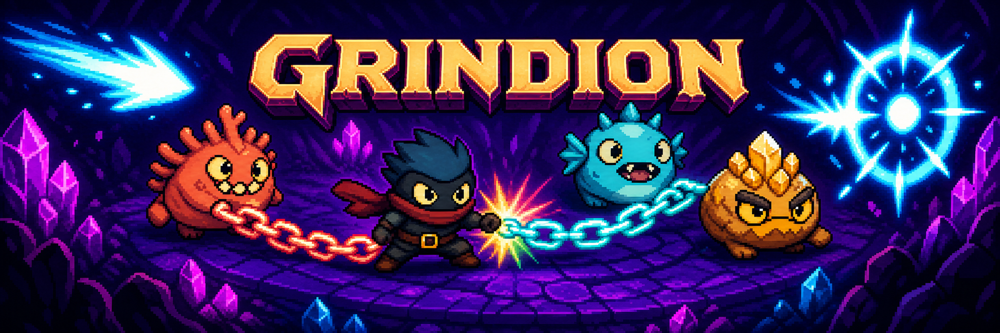

<p align="center">
  
</p>

<p align="center">
  <strong>Chain monsters. Choose your payoff. Spend everything.</strong>
  <br />
  A shared-board puzzle brawler where greed is a route, Power is a promise, and every shot leaves you exposed.
</p>

<p align="center">
  
  
  
  
  
  <a href="https://github.com/ThatXliner/Grindion/actions/workflows/ci.yml"></a>
</p>

## What is Grindion?

Grindion is a competitive `.io` puzzle-combat game played on one continuously replenishing monster field. Drag through matching creatures to move and build a chain, then make the choice that drives the whole game:

- **Bank Score** to grow tougher and heal.
- **Forge Power** to arm one dodgeable, parryable, all-in projectile.

Firing empties your entire Power reserve. If the shot misses—or gets parried—you have just announced to the arena that you cannot defend. Long chains are lucrative, but they also make your route obvious and lock you out of attacking or parrying until you commit or cancel.

> [!NOTE]
> This repository is a **playable, desktop-first vertical slice**: a fixed-seed seven-lesson tutorial, a five-minute solo arena, and instant online play in a server-owned arena. Empty seats are filled by bots; friends can join mid-round through an arena link. Legacy Supabase private room codes remain available for direct challenges.

## Why it hits

| System                 | The interesting decision                                                               |
| ---------------------- | -------------------------------------------------------------------------------------- |
| **Shared chains**      | Route greedily through one live board while rivals compete for the same monsters.      |
| **Score vs. Power**    | Invest in lasting health, or trade the chain for immediate threat.                     |
| **Rainbow Grindstone** | Chain five of one color to unlock a one-use switch into any adjacent color.            |
| **All-in shots**       | Every projectile spends the full reserve, turning each attack into a commitment.       |
| **Timing parries**     | A well-timed defense nullifies any shot, regardless of how powerful the attacker is.   |
| **Comeback pressure**  | Leaders grow with diminishing returns while lower-Score players generate Power faster. |

## Play it locally

You will need a current Node.js LTS release and npm. Node 22 is recommended.

```bash
git clone https://github.com/ThatXliner/Grindion.git
cd Grindion
npm install
npm run dev
```

Open the local URL printed by Vite, then start with **Play Tutorial** or jump directly into **Solo Arena**. Supabase is optional; the full prototype works without it.

## Controls

| Input                                                                  | Action                                              |
| ---------------------------------------------------------------------- | --------------------------------------------------- |
| <kbd>Left drag</kbd> from your hero through matching adjacent monsters | Build a route and chain                             |
| Release                                                                | Move to the chain endpoint and bank Score           |
| <kbd>Shift</kbd> + release                                             | Move to the endpoint and convert the chain to Power |
| Hold <kbd>Right mouse</kbd>                                            | Aim, scout, and zoom out                            |
| Release <kbd>Right mouse</kbd>                                         | Fire every point of stored Power                    |
| <kbd>Space</kbd>                                                       | Parry an incoming projectile                        |
| <kbd>Escape</kbd>                                                      | Cancel the active chain                             |
| <kbd>?</kbd> or <kbd>H</kbd>                                           | Show every control and the rules in-game            |

### The loop in 20 seconds

1. Start next to a monster and drag through adjacent creatures of the same color.
2. Release normally for Score, or hold <kbd>Shift</kbd> while releasing for Power.
3. Keep chaining one color to prime a rainbow color switch after five monsters.
4. Spend Power on a predicted shot—or save enough to parry.
5. Never forget: while you are chaining, you are vulnerable; after you fire, you are empty.

## Realtime multiplayer architecture

The online arena runs the same deterministic TypeScript engine on `big-mac` at 20 Hz and sends WebSocket snapshots and events at 10 Hz. Browsers submit actions; the server assigns each connection its own player ID and advances all humans and bots.

Click **Join Online Arena** to enter an available eight-player arena immediately. A human replaces one bot, and a disconnected player's seat returns to bot control. **Invite Friends** copies a link to that specific running arena. Full public arenas create another arena; a full friend-linked arena reports that it is full. Five-minute rounds automatically restart after a three-second results screen. Empty arenas keep running for one minute before cleanup.

Online play does not require Supabase. The existing Supabase transport is retained only for legacy private challenges. Solo play and the tutorial run locally.

To run online play locally, start the arena worker in another terminal:

```bash
npm run build:arena
npm run start:arena
```

Vite proxies `/api/arena` to the worker on port 8788. Production uses the `arena` and `web` services in `compose.production.yml`, with Nginx forwarding WebSocket upgrades.

## Project map

```text
src/
├── lib/game/              deterministic rules, bots, tutorial, tuning, tests
├── lib/server/            server-owned arenas, bot seats, round lifecycle
├── lib/online/            browser WebSocket client
├── lib/supabase/          browser client + Presence/Broadcast room protocol
├── lib/render/            canvas renderer, cavern floor, particles, hit feedback
└── routes/+page.svelte    HUD, title screen, input, tutorial presentation

static/assets/             banner and original pixel-art sprite sheets
supabase/migrations/       match metadata schema and RLS policies
GAME_DESIGN.md             complete rules, pillars, scope, and architecture
```

Start with [`GAME_DESIGN.md`](./GAME_DESIGN.md) for the full combat model and design rationale. The core simulation entry points are in [`src/lib/game`](./src/lib/game).

## Verification

```bash
npm run lint
npm run check
npm run test:unit -- --run
npm run test:e2e
npm run build
```

The suite covers deterministic engine rules, bot behavior, chain conflicts, the Grindstone switch, tutorial progression, and the browser-level arena flow.

GitHub Actions runs the quality, unit, browser, and production-build checks on every pull request and every push to `main`. Failed browser runs retain a Playwright HTML report for 14 days.

## Supabase Realtime setup

Copy the example environment file and add the browser-safe values for your project:

```bash
cp .env.example .env
```

```dotenv
PUBLIC_SUPABASE_URL=your-project-url
PUBLIC_SUPABASE_PUBLISHABLE_KEY=your-publishable-key
```

Never expose a secret or service-role key through `PUBLIC_*`.

Restart Vite after adding the values. Supabase enables the legacy **Private Rooms** flow for direct challenges by six-character code. **Join Online Arena** uses the standalone arena worker and needs no Supabase configuration.

For a local Supabase stack (Docker required):

```bash
npx supabase start
npx supabase db reset
npx supabase status
```

Use the API URL and publishable/anon key reported by `supabase status`. The existing metadata tables remain protected by RLS; Realtime gameplay does not write per-tick state to those tables.

## Current frontier

The prototype has the core loop, bots, tutorial, public matchmaking, private rooms, readable combat, progression curves, death/respawn, leaderboard, and tests. The big next moves are private-channel authentication for legacy rooms, snapshot interpolation, controller input, larger shared arenas, and another hard round of tuning.

If you are changing rules, keep the simulation deterministic, add the engine-level test first, and update [`GAME_DESIGN.md`](./GAME_DESIGN.md) when the design contract changes.

---

<p align="center">
  <strong>Greed has a cost. Make the chain worth it.</strong>
</p>

## TLS runtime requirement

Use Node.js 22.23.4+, 24.22.1+, or 26.12.1+ for installs, builds, and server execution. Node 23 and 25 are unsupported. These floors include the October 2026 eMudhra CA distrust update.
Restart or rebuild existing deployments after upgrading; an engine declaration alone does not update a running process.
